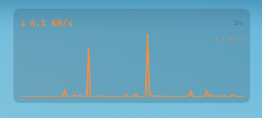
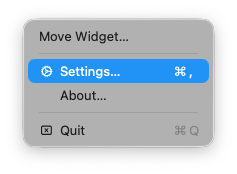
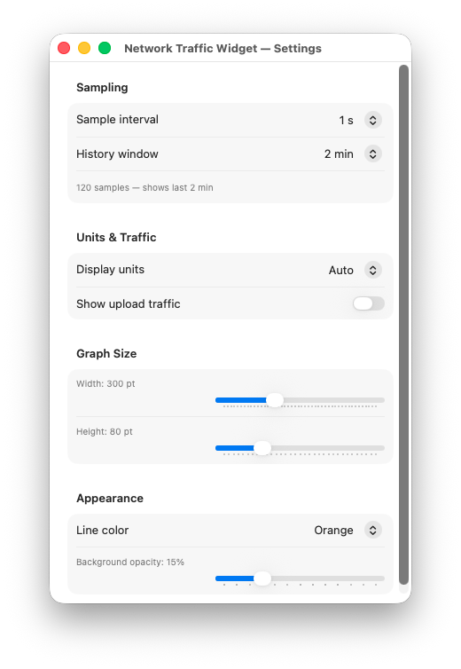
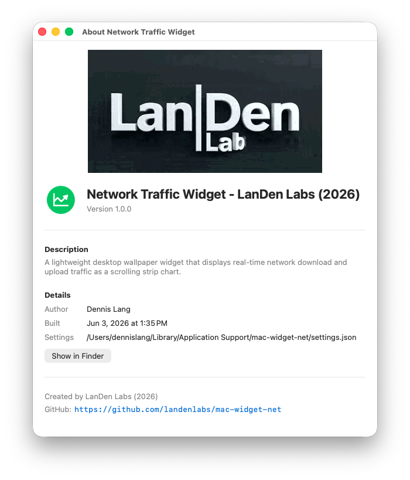

<table border="0">
  <tr>
    <td>
      <!-- VERSION -->v1.0.0
      <!-- DATE -->03-Jun-2026<br>
      macOS<br>
      <a href="https://landenlabs.com">Home</a>
    </td>
    <td>
      <a href="https://landenlabs.com">
        
      </a>
    </td>
  </tr>
</table>

# MacNetWidget


A lightweight, transparent **Network Traffic desktop widget** for macOS. Displays a live scrolling strip chart of download (and optionally upload) bandwidth directly on your desktop wallpaper. Sits as a borderless overlay with no Dock icon, configurable graph size, colors, units, and per-screen position memory.

**By [LanDen Labs](https://github.com/landenlabs) (2026)**

---

## Screenshots

**Widget on desktop — network strip chart**



**Status bar menu**



**Widget settings**



**About dialog**



---

## Features

- **Live strip chart** — scrolling graph of download bandwidth, sampled up to twice per second
- **Optional upload overlay** — toggle upload traffic drawn in orange over the download graph
- **Transparent overlay** — sits directly on the desktop wallpaper, no Dock icon or taskbar clutter
- **Configurable sample interval** — 0.5 s, 1 s, 2 s, 5 s, or 10 s
- **Configurable history window** — 30 s up to 10 min of scrolling data
- **Flexible display units** — Auto, B/s, KB/s, MB/s, bps, Kbps, or Mbps
- **Graph size control** — width 150–600 pt, height 40–200 pt via sliders
- **Line color** — Green, Cyan, Blue, Orange, Yellow, or White
- **Background opacity** — 0–60 % semi-transparent background slider
- **Drag to reposition** — move the widget anywhere on the desktop via the status bar menu
- **Per-screen position memory** — remembers position for every monitor layout independently

---

## Requirements

- macOS 13 (Ventura) or later
- Swift 5.9 / Xcode 15 or later (to build from source)

---

## Installation

### Build from source

```bash
git clone https://github.com/landenlabs/mac-widget-net.git
cd mac-widget-net
swift build -c release
```

The built binary is at:
```
.build/release/mac-widget-net
```

Run it directly or copy it to `/Applications` or any location in your `PATH`.

---

## Usage

The app runs as a **menu bar accessory** — no Dock icon. After launch, look for the download arrow icon in the menu bar.

### Status bar menu

| Item | Action |
|------|--------|
| **Move Widget…** | Enables drag mode — drag the widget anywhere on the desktop, click again to lock |
| **Settings… ⌘,** | Opens the Settings window |
| **About…** | Opens the About dialog |
| **Quit ⌘Q** | Quits the app |

---

## Settings

Open Settings via **Settings… (⌘,)** in the status bar menu.

### Sampling

| Field | Description |
|-------|-------------|
| Sample interval | How often bandwidth is measured: 0.5 s / 1 s / 2 s / 5 s / 10 s |
| History window | How much history the scrolling chart shows: 30 s / 1 min / 2 min / 5 min / 10 min |

### Units & Traffic

| Field | Description |
|-------|-------------|
| Display units | **Auto** scales automatically; fixed units: B/s, KB/s, MB/s, bps, Kbps, Mbps |
| Show upload traffic | Overlays upload rate in orange on the same graph |

### Graph Size

| Field | Description |
|-------|-------------|
| Width | Graph width in points (150–600) |
| Height | Graph height in points (40–200) |

### Appearance

| Field | Description |
|-------|-------------|
| Line color | Download line color: Green / Cyan / Blue / Orange / Yellow / White |
| Background opacity | Semi-transparent background behind the graph (0–60 %) |

Settings are saved automatically to:
```
~/Library/Application Support/mac-widget-net/settings.json
```

---

## Building from Source

### Prerequisites

- macOS 13+
- Swift 5.9+ (ships with Xcode 15+) or standalone Swift toolchain

### Build (debug)

```bash
swift build
```

### Build (release)

```bash
swift build -c release
```

### Run directly

```bash
swift run
```

---

## Project Structure

```
mac-widget-net/
├── Sources/mac-widget-net/
│   ├── main.swift                  # Entry point
│   ├── AppDelegate.swift           # Menu bar setup and window lifecycle
│   ├── AppState.swift              # Observable state, JSON persistence
│   ├── WidgetConfig.swift          # Configuration model, units, colors, screen fingerprinting
│   ├── NetworkMonitor.swift        # Bandwidth sampling via getifaddrs
│   ├── StripChartView.swift        # SwiftUI Canvas strip chart renderer
│   ├── ContentView.swift           # Desktop overlay view (header + chart)
│   ├── DesktopWindowManager.swift  # Borderless window, drag mode
│   ├── DragOverlayView.swift       # AppKit mouse-event capture for drag repositioning
│   ├── SettingsView.swift          # Settings window
│   ├── AboutView.swift             # About dialog
│   └── Version.swift               # App version constant
├── screens/                        # Screenshot assets for README
├── Package.swift
└── README.md
```

---

## Settings File Format

```json
{
  "sampleInterval": 1.0,
  "historySeconds": 60.0,
  "graphWidth": 300.0,
  "graphHeight": 80.0,
  "backgroundOpacity": 0.15,
  "units": "Auto",
  "showUpload": false,
  "graphColor": "Green",
  "positionX": 40.0,
  "positionY": 400.0,
  "screenPositions": {
    "2560x1440@0,0": { "x": 40.0, "y": 400.0 }
  }
}
```

---

## License

Apache 2.0 © Dennis Lang - LanDen Labs (2026)
